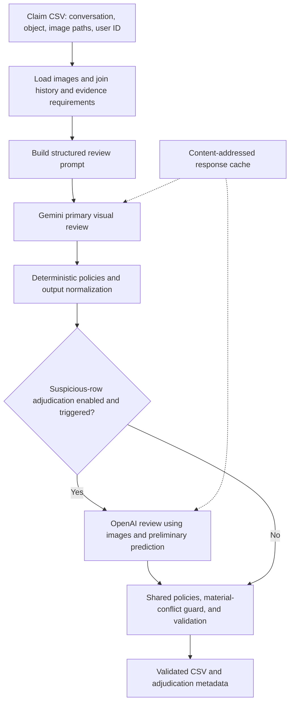

# HackerRank Orchestrate Multimodal Evidence Review

Public repository for my HackerRank Orchestrate June Edition solution.

Final result: **ranked #20 out of 1,773 participants**.

Built for the June 2026 HackerRank Orchestrate challenge. This repository
contains the Python CLI, model integrations, evidence policies, and development
evaluation report. For a concise technical overview and resume wording, see
[Project Summary](docs/PROJECT_SUMMARY.md).

This project builds a multimodal evidence-review system for structured damage
and missing-content claims. Given a claim conversation, submitted images, a
claimed object type, user history, and evidence requirements, the system
predicts whether the visual evidence supports the claim, contradicts it, or is
insufficient.

No private challenge data, API keys, model caches, transcript logs, final
submission outputs, or generated artifacts are intended to be committed to this
public repository.

## What The System Does

The pipeline reviews claims about:

- cars,
- laptops,
- packages.

For each input row, it produces a strict CSV schema with evidence sufficiency,
risk flags, issue taxonomy, relevant object part, claim status, supporting image
IDs, image validity, and severity.

The system is image-first: the claim text tells the model what to inspect, but
the submitted images are treated as the source of truth. User history is used
only for risk and manual-review context, not as proof that a claim is true or
false.

## Architecture

The implementation lives under [`code/`](./code/). The main terminal entry point
is [`code/main.py`](./code/main.py).



Primary-provider failures can also use the configured fallback provider before
the policy layer. If neither provider returns a usable response, the pipeline
uses an explicitly conservative deterministic fallback. Resume support can
reuse completed compatible rows.

Core modules:

- [`code/schema.py`](./code/schema.py): required output schema and allowed
  values.
- [`code/config.py`](./code/config.py): CLI/env configuration.
- [`code/io_utils.py`](./code/io_utils.py): CSV loading, writing, validation,
  and resume helpers.
- [`code/image_utils.py`](./code/image_utils.py): image loading, hashing,
  resizing, content-type detection, and provider-safe encoding.
- [`code/prompts.py`](./code/prompts.py): Gemini/OpenAI prompt construction.
- [`code/gemini_client.py`](./code/gemini_client.py): Gemini vision client.
- [`code/openai_client.py`](./code/openai_client.py): OpenAI-compatible vision
  client.
- [`code/vlm_client.py`](./code/vlm_client.py): provider abstraction, caching,
  JSON parsing, retries, and deterministic fallback handling.
- [`code/rules.py`](./code/rules.py): conservative post-processing rules.
- [`code/validator.py`](./code/validator.py): strict output normalization and
  schema validation.
- [`code/adjudicator.py`](./code/adjudicator.py): suspicious-row adjudication
  logic.
- [`code/pipeline.py`](./code/pipeline.py): end-to-end orchestration.
- [`code/evaluation/main.py`](./code/evaluation/main.py): sample-set evaluation
  dry-run scaffold; it does not calculate accuracy metrics.

## Technology Stack

| Technology | Use in this project |
|---|---|
| Python 3.10+ | CLI, typed data models, orchestration, rules, validation, and CSV I/O |
| Google Gemini API | Primary multimodal evidence review |
| OpenAI API | Optional fallback and suspicious-row vision adjudication |
| Pillow | Image decoding, orientation correction, resizing, and JPEG conversion |
| pandas | CSV I/O when installed; standard-library CSV fallback is also supported |
| certifi | CA certificates for HTTPS API requests |
| REST/HTTPS, JSON, base64 | Direct API requests and image transport using Python `urllib` |
| SHA-256 | Image-content hashes and response-cache identity |
| Git / GitHub | Version control and public source documentation |

The documented challenge run used `gemini-2.5-flash` and `gpt-5-mini` via
environment overrides. These differ from the older fallback defaults in
`code/config.py`; use the explicit model settings shown below when reproducing
the documented configuration. This is a custom Python pipeline; it does not
depend on an agent framework or model-training infrastructure.

## Key Features

- Gemini primary multimodal review with strict JSON output.
- Optional OpenAI-compatible adjudication for suspicious or failed rows, rather
  than calling a second provider for every row.
- Prompt-injection resistance for instructions embedded in claim text or
  images.
- Multilingual/mixed-language claim handling.
- Evidence-requirement aware prompting and validation.
- Deterministic validation of column order, allowed values, lowercase boolean
  strings, missing cells, and supporting image IDs.
- Response caching under `.cache/` to avoid repeated model calls.
- Retry/backoff for transient model API failures.
- Content-based image format detection and conversion of unsupported formats
  such as AVIF/HEIC/WebP before OpenAI-compatible upload.
- Conservative rules for wrong-object evidence, multi-image identity conflict,
  package missing-content claims, and suspicious provenance.

## Setup

Install Python dependencies:

```bash
python3 -m pip install -r requirements.txt
```

Set API keys through environment variables only:

```bash
export GEMINI_API_KEY="..."
export OPENAI_API_KEY="..."  # Optional unless using OpenAI fallback/adjudication.
```

Optional model overrides:

```bash
export GEMINI_MODEL="gemini-2.5-flash"
export OPENAI_MODEL="gpt-5-mini"
```

Do not commit `.env` files, API keys, model caches, or generated outputs.

## Data

The original private challenge dataset and images are not included in this
public repository. The code expects the challenge-style dataset layout when run
locally:

```text
dataset/
  claims.csv
  sample_claims.csv
  user_history.csv
  evidence_requirements.csv
  images/
```

Because the dataset is excluded, public readers will need their own compatible
CSV/image inputs to execute the full pipeline.

## How To Run

Final prediction-style run:

```bash
GEMINI_MODEL="${GEMINI_MODEL:-gemini-2.5-flash}" \
OPENAI_MODEL="${OPENAI_MODEL:-gpt-5-mini}" \
python3 code/main.py \
  --input dataset/claims.csv \
  --output output.csv \
  --primary-provider gemini \
  --fallback-provider openai \
  --adjudicate-suspicious \
  --resume
```

Dry run without model calls:

```bash
python3 code/main.py \
  --input dataset/sample_claims.csv \
  --output /tmp/orchestrate_dry_run.csv \
  --limit 2 \
  --dry-run
```

Gemini-only sample evaluation:

```bash
GEMINI_MODEL="${GEMINI_MODEL:-gemini-2.5-flash}" \
python3 code/main.py \
  --input dataset/sample_claims.csv \
  --output code/evaluation/sample_predictions_gemini_only.csv \
  --primary-provider gemini \
  --fallback-provider none \
  --no-adjudication
```

Gemini plus suspicious-only OpenAI adjudication:

```bash
GEMINI_MODEL="${GEMINI_MODEL:-gemini-2.5-flash}" \
OPENAI_MODEL="${OPENAI_MODEL:-gpt-5-mini}" \
python3 code/main.py \
  --input dataset/sample_claims.csv \
  --output code/evaluation/sample_predictions_openai_adjudicated.csv \
  --primary-provider gemini \
  --fallback-provider openai \
  --adjudicate-suspicious
```

Evaluation scaffold (requires compatible local sample data; makes no model
calls and does not score predictions):

```bash
python3 code/evaluation/main.py \
  --output /tmp/orchestrate_sample_dry_run.csv \
  --limit 2
```

The sample predictions and metrics below were produced during challenge
development. The public repository includes the report, but not the private
labels/predictions or a packaged scoring script. The scaffold checks pipeline
plumbing using a conservative fallback; a dry run is not an accuracy test.

## Evaluation Summary

The final internal sample evaluation compared Gemini-only against Gemini with
suspicious-only OpenAI adjudication:

| Field | Gemini only | Gemini + OpenAI adjudication |
|---|---:|---:|
| `evidence_standard_met` | 16/20 | 20/20 |
| `risk_flags` | 12/20 | 14/20 |
| `issue_type` | 13/20 | 13/20 |
| `object_part` | 18/20 | 17/20 |
| `claim_status` | 15/20 | 18/20 |
| `supporting_image_ids` | 16/20 | 18/20 |
| `valid_image` | 19/20 | 19/20 |
| `severity` | 12/20 | 15/20 |
| Row-level exact match | 8/20 | 8/20 |

These metrics were measured on the provided sample labels during the challenge.
They are useful as a development diagnostic, not as a claim that the same scores
will reproduce on other private or public datasets.

Claim-status agreement rose from **75% to 90%** on that 20-row development
sample, a **15 percentage-point** improvement. Evidence-sufficiency agreement
rose from 80% to 100%, while strict row-level exact match remained **40%**.
The sample was used for development, so these are not held-out benchmark scores.
The report records a final submission workload of **44 claims and 82 images**;
that workload is separate from the labeled sample evaluation.

## Limitations

- The private challenge dataset and final `output.csv` are intentionally not
  included.
- Vision-model judgments can still be uncertain for blurry, cropped, low-light,
  manipulated, or provenance-ambiguous images.
- The system does not perform external image provenance lookup or forensic
  manipulation detection.
- Multi-part conversations are reduced to a single required output row, so some
  edge cases require conservative adjudication.
- Model APIs, pricing, and behavior can change over time; cached results should
  not be treated as universal ground truth.

## Public Repository Hygiene

This repository is prepared so that public commits should contain source code,
documentation, and dependency metadata only. The following are intentionally
ignored:

- private challenge data and images,
- API keys and `.env` files,
- `.cache/` model responses,
- transcript/log files,
- final `output.csv`,
- backup CSVs and zip archives,
- generated prediction CSVs and adjudication JSONL files,
- virtual environments and Python cache files,
- local OS artifacts such as `.DS_Store`.
